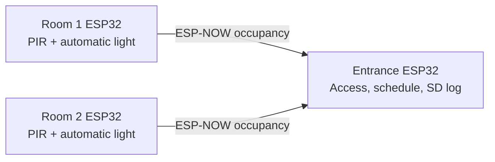

# CoCIS Smart Control System

## Three-terminal design

The system uses one ESP32 at the entrance and one ESP32 in each pilot room. Each
board runs the same application with a different PlatformIO environment:

| Build environment | Board role | Connected devices | Main work |
| --- | --- | --- | --- |
| `entrance` | Entrance controller | Door indicators, alarm, microSD | Access rules, schedule, admin menu, central log |
| `room1` | Lecture Room 1 | PIR on GPIO 34, light on GPIO 32 | Local occupancy detection and automatic lighting |
| `room2` | Lecture Room 2 | PIR on GPIO 35, light on GPIO 33 | Local occupancy detection and automatic lighting |
| `esp32dev` | Single-board Wokwi demo | All demo devices | Runs entrance and both room tasks on one board |

The entrance controller is the source of truth for users, entry/exit state, and
the access schedule. It broadcasts no control decisions to room boards. Room
boards make lighting decisions locally, so a lost radio message cannot turn a
room light off or stop its PIR monitoring.



Wokwi currently supports only one microcontroller per simulation. The root
`diagram.json` is therefore the combined single-board demo. For the three
separate node circuits, open `wokwi/entrance/diagram.json`,
`wokwi/room1/diagram.json`, or `wokwi/room2/diagram.json` and select its sibling
`wokwi.toml` with **Wokwi: Select Config File**. These separate simulations
exercise each board role; ESP-NOW coordination between the three boards is for
the real three-board setup.

## Communication and reliability

Room terminals send a small ESP-NOW status packet when occupancy changes and a
heartbeat every five seconds. The entrance accepts only versioned packets with
a valid room number, records state changes, and shows a room as `STALE` when no
heartbeat has arrived for 15 seconds. This keeps the system useful during a
temporary radio interruption and makes a failed room terminal visible to the
operator. All three boards use Wi-Fi channel 1 and do not need a router or
internet access.

## Access and records

The entrance serial menu accepts RFID UIDs using `scan in <UID>` and
`scan out <UID>`. This provides repeatable tag-present demonstrations without
requiring extra reader hardware in the Wokwi setup. The entrance enforces the
configured opening window and anti-passback, tracks who is inside, locks a
reader briefly after repeated denied scans, and writes access/configuration data
to microSD when available. Admin-only commands require a PIN; its stored value
is SHA-256 hashed through the ESP-IDF PSA crypto API.

Room nodes control lights from their own PIR sensors and turn them off after a
20-second idle interval. The one-board demo also shows the room activity
locally and can raise the example unbadged-motion alert. The three-board builds
keep room sensing independent from entrance occupancy so a radio outage does
not interfere with lighting. Configured indicator and room-light outputs are
initialized off at startup; the entry indicator turns on only while an
authorized entry gate is open. Room PIR readings are ignored until the sensor
first reports idle, preventing an active-at-boot signal from turning a light on.

The status `Inside (badged)` count is based on badge-ins without a matching
badge-out; room motion does not change it. Since this count is restored from
microSD after a restart, an admin can use `clearinside` after confirming the
building is empty to clear and save stale badge-in states.

## Build and demo

Build each image from the project directory:

```sh
pio run -e entrance
pio run -e room1
pio run -e room2
pio run -e esp32dev
```

Flash `entrance`, `room1`, and `room2` to the corresponding boards. For the
single-board Wokwi demo, use `esp32dev`; it retains the serial menu and the
existing wiring in `diagram.json`.

Useful entrance commands include `help`, `status`, `scan in A1B2C3D4`,
`scan out A1B2C3D4`, and `login 1234`. After login, use commands such as
`clearinside` (only after confirming the building is empty),
`schedule 07:00 22:00`, `settime 06:55`, and `passwd <new-pin>`.
